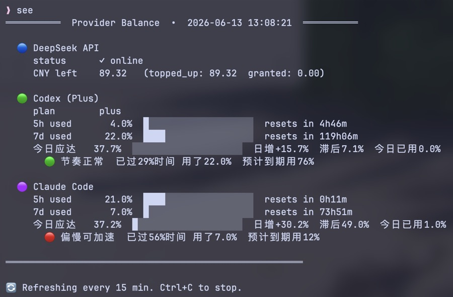

# see-balance

查看 DeepSeek / Codex / Claude Code / Antigravity (AGY) / Grok (xAI) 五个 AI provider 的余额和用量。

## 安装

```bash
bash install.sh
```

安装做了三件事：
1. 复制 `provider_balance.py` 到 `~/bin/`
2. 创建配置文件 `~/.see-balance.env`（如果不存在）
3. 提示你添加 shell alias

## 配置

编辑 `~/.see-balance.env`：

```bash
DEEPSEEK_API_KEY=sk-your-key-here
# 可选：手动指定 XAI_API_KEY
# XAI_API_KEY=xai-your-key-here

# 如需代理（VPN 场景）：
# HTTPS_PROXY=http://127.0.0.1:7890
```

- **DeepSeek key**：[platform.deepseek.com/api_keys](https://platform.deepseek.com/api_keys)
- **Codex**：自动读取 `~/.codex/auth.json`（运行 `codex login` 生成）
- **Claude Code**：自动读取 macOS Keychain（`claude /login` 登录后自动写入）；Keychain 条目缺失或为空时回退到 `~/.claude/.credentials.json`（遵循 `CLAUDE_CONFIG_DIR`）
- **Grok (xAI)**：自动读取 `~/.grok/auth.json`（运行 `grok` / `grok login` 生成）或 `XAI_API_KEY`，直连 `cli-chat-proxy.grok.com` 查询：
  - **主周池**（Chat · Imagine · Voice · Build）：7d 使用百分比、进度与重置倒计时；
  - **Grok Bot 池**（Bot / Cursor 独立周额度）：独立周额度不占用主池；支持在 `~/.see-balance.env` 配置 `CURSOR_SESSION_TOKEN` 同步实测用量。
- **Antigravity (AGY)**：自动读取 macOS Keychain / Google OAuth 凭据，识别 `paidTier` 套餐；直连服务端 `retrieveUserQuotaSummary` 读真实配额。

两个互不相通的池，各自带 **5h + weekly** 两个窗口：

| 池 | bucketId | 覆盖 |
|---|---|---|
| Gemini 池 | `gemini-5h` / `gemini-weekly` | Gemini Flash / Pro |
| Claude·GPT 池（3P） | `3p-5h` / `3p-weekly` | Claude Opus / Sonnet / GPT-OSS |

配额单位是 `remainingFraction`（**按 token 成本扣，不是请求次数**）。官方从没公布 5h 的数值阈值，只说过 *"refreshed every five hours until the weekly limit is reached"*。
> ⚠️ 旧版本会把 free-tier 推销文案里的 “1,500 requests/day with Gemini CLI” 当成 AGY 配额 —— 那是 Gemini CLI / Code Assist 的口径，与 Antigravity agent 的配额不是一回事，已在 2026-10-03 修正。本地日志统计的请求数现在单独列为「本地计数」，仅作参考。

## 使用

```bash
# 推荐：加 alias 到 ~/.zshrc
alias see="python3 ~/bin/provider_balance.py --watch 15"

see                  # 每 15 分钟刷新
python3 ~/bin/provider_balance.py          # 一次性查询
python3 ~/bin/provider_balance.py --watch 30   # 每 30 分钟
python3 ~/bin/provider_balance.py --compact    # 每 provider 一行
python3 ~/bin/provider_balance.py --json       # 原始 JSON
python3 ~/bin/provider_balance.py --no-pet     # 不显示 Claude 宠物（或设 SEE_BALANCE_PET=0）
python3 ~/bin/provider_balance.py --pet-demo   # 不查接口，演示宠物的每种情绪
python3 ~/bin/provider_balance.py --update     # 马上检查并安装上游最新版
python3 ~/bin/provider_balance.py --version    # 看当前版本
python3 ~/bin/provider_balance.py --no-update  # 这次不检查更新（或设 SEE_BALANCE_UPDATE=0）
python3 ~/bin/provider_balance.py --install-hooks    # 开启会话提醒（见下）
python3 ~/bin/provider_balance.py --uninstall-hooks  # 关掉会话提醒
```

`--watch` 在终端里运行时支持快捷键：**`p`** 显示/隐藏宠物，**`s`** 切换宠物（猫 / 兔子 / 小熊），**`r`** 立即刷新，**`q`** 退出；有新版本时还有 **`u`** / **`k`** / **`n`**（见下）。

## 会话提醒

Claude Code / Grok CLI 的会话在等你做决定时，宠物会挥手提醒你，底部列出是哪个项目的哪个会话、等了多久、问的是什么：

```
🔔 see-balance 的 Claude 在等你确认（0h03m 前）：Claude needs your permission to use Bash
🔔 Agent24 的 Grok 在等你回复（0h12m 前）：要不要我推送到 fork？
```

- **算“等你”的**：弹出权限确认 / MCP 表单（子 agent 弹的也算）；或者最后一句话在问你（以 `?` / `？` 结尾，正文中间的问号不算），之后一直没动静。干完活单纯空闲的不算。
- **自动消失**：你回了话、这一轮结束（包括出错结束、在 Grok 里拒绝权限）、会话关了，或者会话在提醒之后又有了新进展（你已经在终端里处理了）。超过 12 小时的提醒也不再显示。上一轮迟到的结束事件不会清掉这一轮的提醒；子 agent 这一轮结束只清它自己弹的提醒。
- **只提醒，不代你批准**：回原来的终端作答。
- **开启**：运行一次 `--install-hooks`。它会写一个只记录的 hook（`~/.see-balance/hook.py`），挂到 `~/.claude/settings.json` 的 `Notification` / `UserPromptSubmit` / `Stop` / `StopFailure` / `SessionEnd` 上。Grok CLI 默认也读这个文件，所以两边都能覆盖；另外在 `~/.grok/hooks/see-balance.json` 挂一个只有 Grok 认识的 `StopCancelled`（在 Grok 里拒绝权限时用来清掉提醒）。新开的会话开始生效。`--uninstall-hooks` 只摘掉它自己装的那几条（看不懂的结构、你自己的 hook、原本就空的事件都不动）。
  - 改文件前备份为 `*.see-balance.bak`；已有的 hook 不动；`settings.json` 是符号链接（dotfiles）时改的是链接目标，权限不变。
  - hook 命令永远以 0 退出、不输出任何东西：哪怕 `hook.py` 被删了，也不会拦下你的输入或打断会话。
- hook 只往 `~/.see-balance/attention.jsonl` 追加一行：会话 id、目录、事件类型和一小段说明（权限提示文字或最后那句问话），不记工具输入输出。显示前会去掉其中的控制字符，会话里的文字改不了你的终端。
- 宠物上的优先级：会话提醒 > 升级选项 > 用量情绪。
- 日志超过 1MB 时轮换，只保留 12 小时内的记录，还在等的提醒不会丢。
- Codex、Antigravity 暂时没有可靠的“在等你”信号，还不支持。

## 自动更新

每天最多查一次上游 [`main` 分支](https://github.com/jhfnetboy/see-balance/blob/main/provider_balance.py)上的 `__version__`，比本地新就：

1. 先下载到 `~/.see-balance/update/` 暂存（下载完会检查能否编译、有没有版本号，不完整就不用）；
2. `--watch` 里宠物举牌弹出升级选项（宠物藏起来时底部也有同样一行）：

   ```
    .---------------------------.
   ( 新版本 v1.3.0！u 立即升级 )
   ( k 跳过本次 · n 不要提醒   )
    '---.-----------------------'
   ```

   - **`u` 立即升级**：装好后自动重启，旧版本留一份 `provider_balance.py.bak`
   - **`k` 跳过本次**：先收起来，下次刷新再提醒
   - **`n` 不要提醒**：这个版本不再提醒；出了更新的版本，或重启后，才会再弹
3. 一次性查询时在末尾提示，运行 `--update` 安装。

从 see-balance 的 git checkout 里直接运行时，只读上游的版本号、提示 `git pull`，不会暂存或覆盖工作区。

- 没查成（断网、上游内容不完整）时过 1 小时再试；`--update` 失败时退出码为 1。
- `--json` / `--compact` 是给脚本用的：不联网查更新，输出里也没有更新相关字段。
- 暂存目录必须是你自己的、别人写不进的目录（`SEE_BALANCE_STATE` 指到 `/tmp` 这类共享目录时不会暂存）。
- 另一个终端已经装好更新的版本时，旧进程不会再装回暂存里的较低版本；上游回滚后，暂存里的高版本会被丢弃。

> 维护者注意：要推给用户的改动，合入前把 `provider_balance.py` 顶部的 `__version__` 调大，否则已安装的副本不会提示更新。

## Claude 宠物

完整视图右下角有一只 ASCII 宠物（猫 / 兔子 / 小熊，按 `s` 切换，选择记在 `state.json` 里），只看 **Claude** 的用量，按优先级从高到低换情绪：

| 情绪 | 什么时候 |
|---|---|
| 叫你 | 有 Claude Code / Grok 会话在等你确认或回复（见「会话提醒」），排在最前面 |
| 升级 | 有下载好的新版本：举牌弹出升级选项，排在用量情绪前面，选完就让开 |
| 开心 | 7d 周额度用完（≥ 99.5%） |
| 献爱心（提醒休息） | 7d 按当前进度预计到期用量 > 120%；或 5h 已用满；或按实测速率 5h 会在重置前见底 |
| 生气 | 7d 窗口重置时，上一周最后用量 < 90%（重置后 12h 内） |
| 鼓励 | 7d 预计到期用量 ≤ 75% |
| 日常 | 其它情况：每隔几秒随机发呆、摇尾巴、东张西望、打哈欠、舔爪、伸懒腰、睡觉 |

- 宠物优先贴着终端右下角；那几行的正文太宽时，就近往上找一块空位；哪儿都放不下时会隐藏，并在 footer 下提示需要多宽的终端。
- 一次性查询时显示静态的一帧；`--compact`、`--json` 和管道输出不显示宠物。
- “生气”要知道上周最后的用量，所以会在 `state.json` 的 `pet` 段记下 Claude 7d 窗口的位置。
- 画风参考 [ts-animal](https://github.com/ts-animal/ts-animal)（MIT）的颜文字动物，帧为本项目自绘。

## 输出示例



每个 provider 显示进度条与节奏分析：
- **5h used / 7d used** — 各窗口用量（AGY 按池分开显示 G-5h / G-7d / 3P-5h / 3P-7d）
- **进度应达** — 线性时间进度应达百分比 + 当前进度超前/还差评估
- **节奏评估** — 🟢 节奏正常 / 🟡 偏快需注意 / 🔴 超速需节约 / 🔴 偏慢可加速（附已过时间、当前消耗与到期预计）
- **实测消耗** — 从历史快照算出的真实速率：`+1.4%/h`（额度窗口）或 `¥0.69/h`（DeepSeek 现金）
- **建议** — 把速率翻译成结论：**能不能撑到重置**（`⚠ 2.6h 后见底，比重置早 56h`）或在闸门内（`今日将花 ¥13.52（闸门 ¥9.00 ⚠ 会超）`）
- **增量消费** — 两次查询之间的新增消费

`--compact` 每行末尾会带速率后缀：`⇣+1.4%/h≈3h`（按此速率还有 3h 见底）。

## 状态缓存

用量快照保存在 `~/.see-balance/state.json`，用途：
- `history` 数组：每次查询追一条样本（保留 14 天 / 4000 条），**实测消耗速率就从这里算** —— 跨重启、跨终端都不断（重启进程不会丢速率）。
- `daily_baselines`：当天开头各窗口的基线，用于算「进度应达」。

可用环境变量：

| 变量 | 作用 |
|---|---|
| `SEE_BALANCE_STATE` | 换一个 state 文件（测试 / 多账号） |
| `SEE_BALANCE_UPDATE` | 设成 `0` 关掉每日更新检查 |
| `SEE_BALANCE_UPDATE_URL` | 换一个更新源（测试用） |
| `SEE_BALANCE_CLAUDE_SETTINGS` | `--install-hooks` 改哪个 settings 文件（默认 `~/.claude/settings.json`，测试用） |
| `SEE_BALANCE_CNY_DAILY_CAP` | DeepSeek 当日人民币闸门（例 `9`），设了就会给「安全 / 会超」判定 |
| `HTTPS_PROXY` | 访问 api.deepseek.com / chatgpt.com 的代理 |

速率的可信度取决于采样密度：`--watch 15` 下几小时内就很准；只跑两次相隔 1 分钟是看不到速率的（跨度 < 3 分钟直接不出值，避免噪声）。

## 更新

```bash
# 修改源文件后重新安装
cd ~/Dev/tools/see-balance
# 编辑 provider_balance.py
bash install.sh
```
